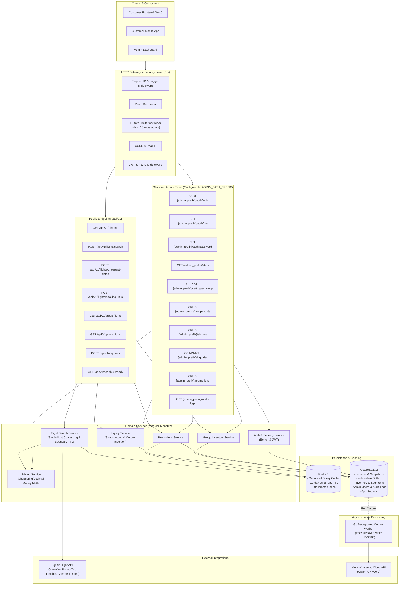
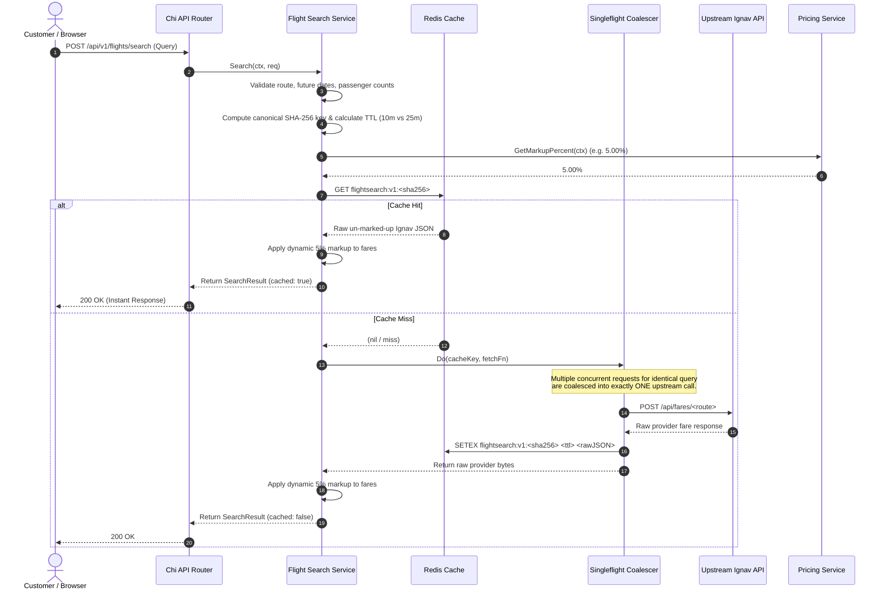
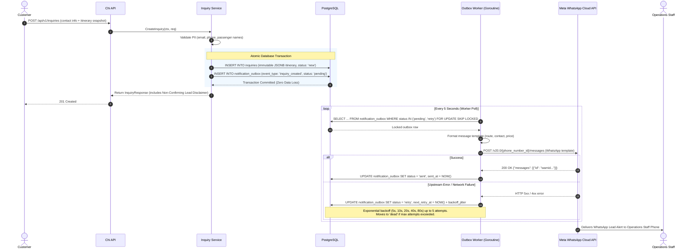
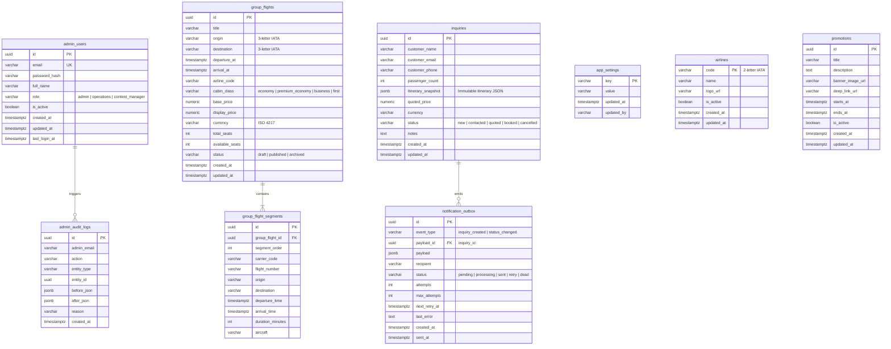
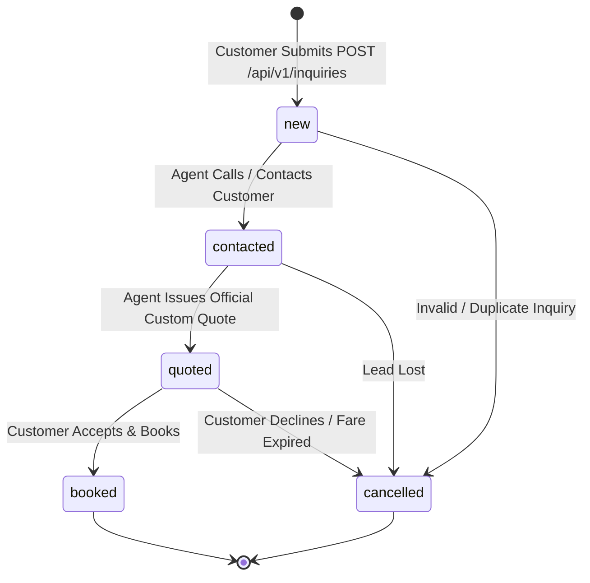
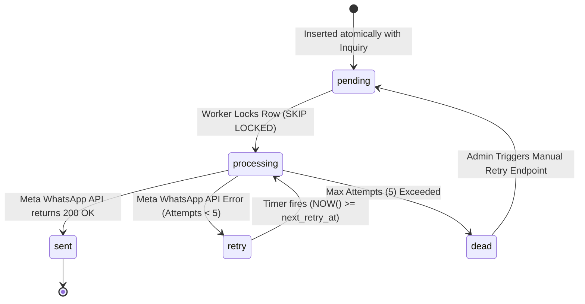

# Flight Ticket Search & Group-Ticket Booking Inquiry Platform

A production-ready Go backend for flight ticket search, Redis caching, dynamic fare markup, group-ticket inventory management, customer inquiries, and Meta WhatsApp Cloud notifications via a transactional outbox pattern.

---

## 1. High-Level Design (HLD)

### 1.1 Platform Architecture Overview

The system is architected as a **modular monolith** in Go, combining clean domain isolation with horizontal scalability, resilient caching, and reliable asynchronous notifications.



---

### 1.2 Flight Search Flow with Redis Caching & Singleflight



---

### 1.3 Customer Inquiry & Transactional Outbox Flow



---

## 2. Low-Level Design (LLD)

### 2.1 Database Schema (ERD)



---

### 2.2 Inquiry Lifecycle State Machine



---

### 2.3 Notification Outbox State Machine



---

## 3. Technology Stack

| Component | Technology | Rationale |
| :--- | :--- | :--- |
| **Language** | **Go (Golang)** | High concurrency, low memory footprint, compiled native binary. |
| **HTTP Framework** | **Chi (`go-chi/chi/v5`)** | Lightweight, 100% `net/http` compatible, idiomatic composable middleware. |
| **Database** | **PostgreSQL 16** | ACID transactions, native JSONB, `SKIP LOCKED` concurrency. |
| **Database Driver** | **`pgx/v5`** | High-performance PostgreSQL driver and connection pooling for Go. |
| **Database Migrations** | **Embedded SQL Migrations** | Zero external runtime migration tool dependencies; embedded via `embed.FS`. |
| **Caching** | **Redis 7 (`go-redis/v9`)** | Sub-millisecond deterministic caching, exact TTL expiration rules. |
| **Money Arithmetic** | **`shopspring/decimal`** | Exact decimal precision; zero floating-point rounding errors for money. |
| **Request Coalescing** | **`golang.org/x/sync/singleflight`** | Merges duplicate concurrent cache misses into a single upstream API call. |
| **Structured Logging** | **`log/slog`** | Built-in JSON structured logging with custom PII phone & email redaction. |
| **Authentication & RBAC** | **JWT (`golang-jwt/jwt/v5`) & Bcrypt** | Stateless cryptographic auth tokens with role verification. |
| **External Flight Provider**| **Ignav API (`https://ignav.com`)** | One-Way, Round-Trip, Flexible Search, Cheapest Dates, Booking Links, Airports. |
| **Notifications** | **Meta WhatsApp Cloud API** | Official Facebook Graph API v20.0 for instant lead notification to agents. |
| **API Contract** | **OpenAPI 3.1** | Standard contract definition in [`api/openapi.yaml`](file:///home/zenith/.gemini/antigravity-ide/scratch/flight-platform/api/openapi.yaml). |

---

## 4. Security & Administration

### 4.1 Unpredictable Admin Panel Prefix (Zero Bot Scanning)

By default, bot scanners probe `/admin` or `/api/v1/admin`. To prevent reconnaissance, the entire admin surface is mounted under a configurable, unpredictable path prefix defined in `.env`:

```env
ADMIN_PATH_PREFIX=/portal-admin-8f2a9c
```

* Requesting `http://localhost:8080/admin` or `/api/v1/admin` returns `404 Not Found`.
* The admin panel and authentication are only reachable via `http://localhost:8080/portal-admin-8f2a9c/...`.
* You can change this to any random token or custom path in `.env`.

### 4.2 Admin Credentials & Password Management

#### Setup & Synchronization via Environment Variables
Admin credentials can be configured directly in `.env` / `deploy/.env`:

```env
ADMIN_INITIAL_EMAIL=admin@flightplatform.local
ADMIN_INITIAL_PASSWORD=AdminSecret123!
```

* **Startup Synchronization:** When the backend starts up, it automatically verifies that this admin user exists and synchronizes the bcrypt password hash in PostgreSQL.
* **Emergency Reset via `.env`:** If you ever need to reset the admin password directly from the server environment, simply change `ADMIN_INITIAL_PASSWORD=NewSecret123!` in `.env` and restart the container (`docker compose up -d`).

#### Changing Password via API Endpoint
An authenticated administrator can also change their password at any time:

* **Endpoint:** `PUT {ADMIN_PATH_PREFIX}/auth/password`
* **Header:** `Authorization: Bearer <jwt_token>`
* **Request Body:**
  ```json
  {
    "old_password": "AdminSecret123!",
    "new_password": "NewSecretPass456!"
  }
  ```
* **Response:**
  ```json
  {
    "message": "Password updated successfully"
  }
  ```

---

## 5. API Reference Summary

### 5.1 Public Endpoints

| Method | Endpoint | Description |
| :--- | :--- | :--- |
| `GET` | `/health` or `/api/v1/health` | Liveness probe (process up) |
| `GET` | `/ready` or `/api/v1/ready` | Readiness probe (verifies PostgreSQL & Redis connections) |
| `GET` | `/api/v1/airports?q=...&limit=...` | Airport autocomplete search (cached 12h in Redis) |
| `POST`| `/api/v1/flights/search` | One-way, round-trip, and flexible multi-city flight search with dynamic markup |
| `POST`| `/api/v1/flights/cheapest-dates` | Calendar of lowest fares across a 1–31 day date window |
| `POST`| `/api/v1/flights/booking-links` | Retrieve direct booking links by `ignav_id` or manual flight details |
| `GET` | `/api/v1/group-flights` | Search published group-ticket inventories |
| `GET` | `/api/v1/group-flights/{id}` | Detailed segment breakdown for a published group flight |
| `GET` | `/api/v1/promotions` | Active promotional homepage banners |
| `POST`| `/api/v1/inquiries` | Submit customer flight booking inquiry (emits WhatsApp outbox event) |

### 5.2 Admin Endpoints (`{ADMIN_PATH_PREFIX}` = `/portal-admin-8f2a9c`)

| Method | Endpoint | Required Role | Description |
| :--- | :--- | :--- | :--- |
| `POST`| `{admin_prefix}/auth/login` | Public | Login with email and password, returns JWT token |
| `POST`| `{admin_prefix}/auth/logout` | Public | Logout |
| `GET` | `{admin_prefix}/auth/me` | Any Admin | View current admin profile |
| `PUT` | `{admin_prefix}/auth/password` | Any Admin | Change password |
| `GET` | `{admin_prefix}/stats` | Any Admin | Dashboard metrics (inquiries, inventory, outbox) |
| `GET` | `{admin_prefix}/settings/markup` | `admin` | View current fare markup percentage |
| `PUT` | `{admin_prefix}/settings/markup` | `admin` | Update dynamic markup percentage |
| `GET` | `{admin_prefix}/audit-logs` | `admin` | View administrative audit log entries |
| `GET` | `{admin_prefix}/airlines` | `admin`, `operations` | List airline catalogue |
| `POST`| `{admin_prefix}/airlines` | `admin`, `operations` | Create airline record |
| `PATCH`| `{admin_prefix}/airlines/{id}` | `admin`, `operations` | Update airline details |
| `DELETE`| `{admin_prefix}/airlines/{id}` | `admin`, `operations` | Delete airline record |
| `GET` | `{admin_prefix}/group-flights` | `admin`, `operations` | List all group flights (including drafts) |
| `POST`| `{admin_prefix}/group-flights` | `admin`, `operations` | Create group flight with segments |
| `POST`| `{admin_prefix}/group-flights/{id}/publish` | `admin`, `operations` | Publish group flight listing |
| `POST`| `{admin_prefix}/group-flights/{id}/availability` | `admin`, `operations` | Adjust seats with audit record |
| `DELETE`| `{admin_prefix}/group-flights/{id}` | `admin`, `operations` | Delete group flight |
| `GET` | `{admin_prefix}/inquiries` | `admin`, `operations` | List customer inquiries with status filter |
| `GET` | `{admin_prefix}/inquiries/{id}` | `admin`, `operations` | View customer inquiry and itinerary snapshot |
| `PATCH`| `{admin_prefix}/inquiries/{id}` | `admin`, `operations` | Update inquiry status (`contacted`, `booked`, etc.) |
| `POST`| `{admin_prefix}/inquiries/{id}/retry-notification` | `admin`, `operations` | Re-queue failed/dead WhatsApp notification |
| `GET` | `{admin_prefix}/promotions` | `admin`, `content_manager` | List promotions |
| `POST`| `{admin_prefix}/promotions` | `admin`, `content_manager` | Create promotion banner |
| `PATCH`| `{admin_prefix}/promotions/{id}` | `admin`, `content_manager` | Update promotion banner |
| `DELETE`| `{admin_prefix}/promotions/{id}` | `admin`, `content_manager` | Delete promotion |

---

## 6. Getting Started & Deployment

### 6.1 Prerequisites
* Docker and Docker Compose (v2+)
* Go 1.24+ (if running tests locally)

### 6.2 Running with Docker Compose

1. Clone or navigate to the repository directory:
   ```bash
   cd /home/zenith/.gemini/antigravity-ide/scratch/flight-platform
   ```

2. Review or update your configuration in `deploy/.env`:
   ```bash
   # Ignav Flight Provider
   IGNAV_API_KEY=your_ignav_api_key_here

   # Unpredictable Admin Endpoint Prefix
   ADMIN_PATH_PREFIX=/portal-admin-8f2a9c

   # Admin Credentials
   ADMIN_INITIAL_EMAIL=admin@flightplatform.local
   ADMIN_INITIAL_PASSWORD=AdminSecret123!
   ```

3. Start all services in detached mode:
   ```bash
   docker compose -f deploy/compose.yaml up -d
   ```

4. Verify service readiness:
   ```bash
   curl -i http://localhost:8080/api/v1/ready
   ```

5. Test Admin Login:
   ```bash
   curl -X POST http://localhost:8080/portal-admin-8f2a9c/auth/login \
     -H "Content-Type: application/json" \
     -d '{"email":"admin@flightplatform.local","password":"AdminSecret123!"}'
   ```

---

## 7. Testing & Quality Assurance

Run the comprehensive unit and integration test suite:

```bash
# Run all unit and integration tests without cache
go test -v -count=1 ./...
```

* **Test Coverage Highlights:**
  * Exact 10-day vs 11-day boundary TTL validation.
  * SHA-256 canonical cache key determinism and sorting.
  * Money rounding per currency minor unit (0 for JPY, 3 for BHD, 2 for USD).
  * `singleflight` concurrent request deduplication.
  * Redis outage graceful fallback.
  * PII phone and email redaction in structured logs.
  * End-to-end flight search, markup, and inquiry notification workflow.
